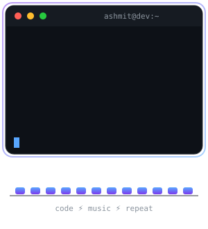
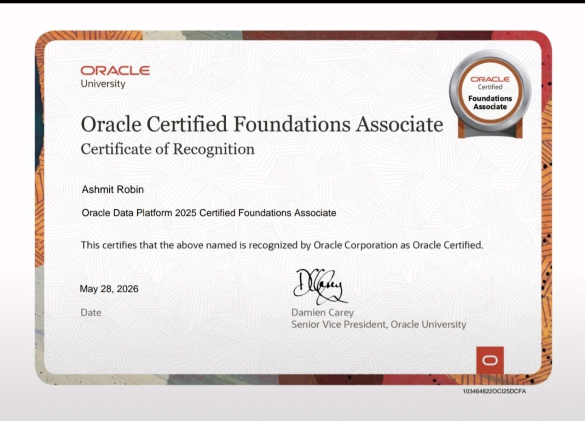
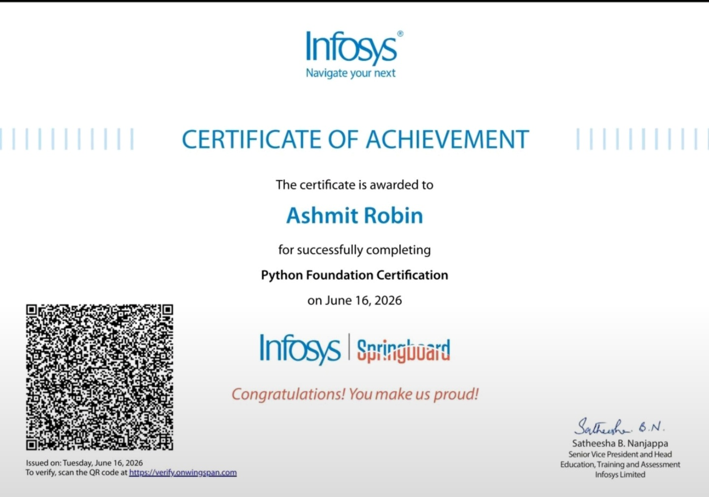
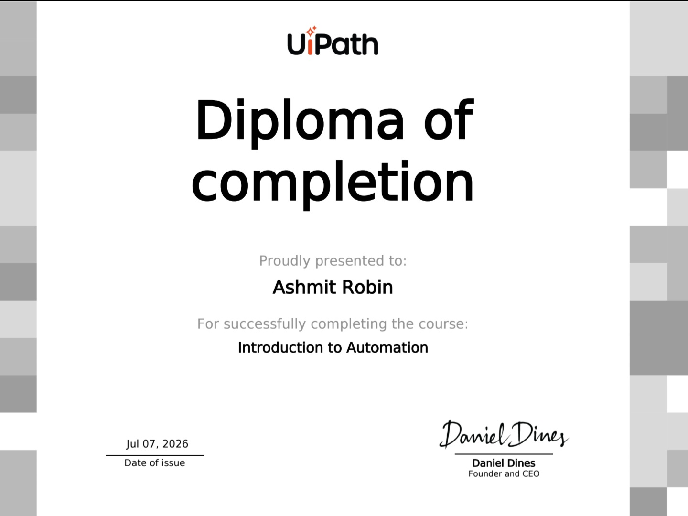
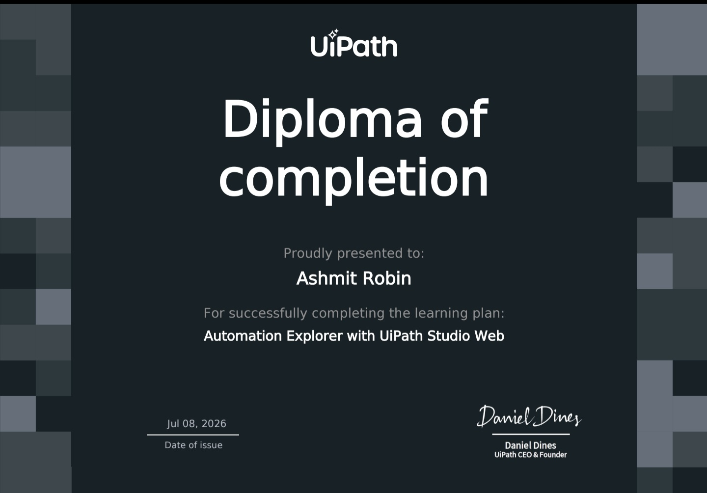

<!-- ============ HERO ============ -->

  

  

    

  
  
  

   

  
  
  
  

 

<!-- ============ ABOUT ============ -->

  

<table>
  <tr>
    <td width="62%" valign="top">

 Hey! I'm **Ashmit Robin**, a second-year BCA student at **Christ University, Bengaluru**. I love crafting efficient, clean and user-friendly software, whether it's backend logic or frontend magic. When I'm not coding, I'm probably exploring new tech stacks or jamming on my guitar.

- 💼 **Full Stack Developer Intern** at **Centre for AI, Christ University**
- 🧳 Ex-Summer intern at **Suvidha Foundation**
- 🌱 Exploring: Full Stack, APIs and Cloud, DSA in C++
- 🎸 Lead Guitarist, **Aakrosh Band** (Dept. of Professional Studies)

</td>
    <td width="38%" align="center">
      
    </td>
  </tr>
</table>

<!-- ============ PRESENT STATUS ============ -->

  

<table>
  <tr>
    <td width="60%" valign="top">

| | |
|---|---|
| 🔨 **Building** | Full-stack web apps with React, Node.js and MySQL |
| 🏢 **Interning** | Full Stack Developer at Centre for AI, Christ University |
| 📚 **Strengthening** | Java, Python and C++ |
| 🧩 **Practicing** | Data Structures and Algorithms |
| 🔌 **Learning** | Backend development and API design |
| 🤖 **Experimenting** | Automation with UiPath |
| 🎯 **Working towards** | Becoming a stronger software engineer |

</td>
    <td width="40%" align="center">
      
    </td>
  </tr>
</table>

<!-- ============ TECH ARSENAL ============ -->

  
    
  

 

<!-- ============ SPOTLIGHT PROJECT ============ -->

  

  <h3>📊 Faculty Analytical Dashboard</h3>

  

  

    A full-stack analytics dashboard where faculty records are entered and stored in a <b>MySQL database</b> and the app turns them into live statistics and charts, such as faculty by designation, faculty by department and top colleges by faculty count. Built with <b>React + Node.js</b>.
  

  
  
  
  

  
<a href="https://github.com/AshmitRobin/Faculty-Analytical-Dashboard"><b>➜ View the repository</b></a>

<!-- ============ GITHUB PULSE ============ -->

  
    
  

 

<!-- ============ CONTRIBUTION ============ -->

  
    
  <picture>
    <source media="(prefers-color-scheme: dark)" srcset="https://raw.githubusercontent.com/AshmitRobin/AshmitRobin/output/github-snake-dark.svg" />
    <source media="(prefers-color-scheme: light)" srcset="https://raw.githubusercontent.com/AshmitRobin/AshmitRobin/output/github-snake.svg" />
    
  </picture>
    
  

 

<!-- ============ CERTIFICATIONS ============ -->

  

  <h4>🏅 Oracle Data Platform 2025: Certified Foundations Associate</h4>
  Oracle University • May 2026  
  

  <h4>🐍 Python Foundation Certification</h4>
  Infosys Springboard • Jun 2026  
  

  <h4>🤖 Introduction to Automation</h4>
  UiPath • Jul 2026  
  

  <h4>⚙️ Automation Explorer with UiPath Studio Web</h4>
  UiPath • Jul 2026  
  

 

<!-- ============ GET IN TOUCH ============ -->

  
    
  
  
  
  

    
  
  

